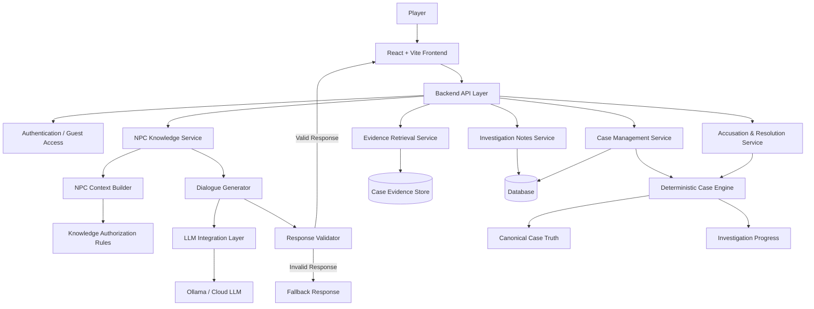

# RED THREAD — Dynamic AI-Driven Detective Game

**An AI-powered detective game built with deterministic case logic and LLM-driven NPC conversations.**

**Team:** Team Quantum  
**Programme:** EPAM Centre of Excellence, LNCT  
**Project Domain:** Gaming · Generative AI · Conversational AI  
**Version:** 

---

## Overview

**Red Thread** is an AI-powered detective game in which players investigate a mystery by exploring evidence, reviewing case notes, and interrogating non-player characters (NPCs).

NPCs respond naturally through a Large Language Model (LLM). However, the LLM does not control the truth of the mystery. The Case Engine remains the authoritative source for case facts, NPC Knowledge controls what each character is allowed to know, and a validation layer checks generated dialogue before it reaches the player.

> **Core principle:** The Case Engine owns the truth. The LLM owns the voice. The validation layer protects the mystery.


---

## Key Features

### Investigation and Gameplay

- Detective-game landing and entry experience.
- Case selection with playable and locked case states.
- Case dashboard with case brief and investigation progress.
- NPC directory with stable character identifiers.
- NPC interrogation interface for player questions and AI-generated responses.
- Evidence board for viewing and collecting case clues.

### AI-Powered NPC Interrogation

- NPC-specific context assembled by trusted backend logic.
- LLM-generated dialogue based on the NPC's personality and authorized knowledge.
- Conversation context supplied in a bounded manner.
- Cover stories treated as permitted character statements, not canonical truth.
- Unknown NPCs and unauthorized information requests handled safely.


### Case Integrity and Validation

- Deterministic case data is the source of truth.
- NPCs cannot automatically access the complete case solution.
- Facts are filtered according to NPC permissions and investigation progression.
- Future facts are withheld until their configured reveal stage.
- Generated responses are validated before being displayed.
- Final accusations are evaluated by deterministic backend logic, not by the LLM.

### Evidence and Investigation State

- Stable IDs for cases, NPCs, facts, and evidence.
- Evidence visibility follows case discovery rules.
- Evidence collection should be safe against duplicate requests.
- Player notes and progress are scoped to the active case and player.
- Investigation progress is derived from backend state rather than arbitrary frontend values.

---


# Architecture
- Sample ( need to update)



### Main Components

| Component | Responsibility |
|---|---|
| Frontend | Screens, navigation, interrogation chat, evidence and notes UI |
| Backend API | Request handling, orchestration, validation and business logic |
| Case Engine | Loads authoritative case data, facts, progression and solution |
| NPC Knowledge | Builds the information an NPC is permitted to know |
| Dialogue Generator | Produces natural-language candidate dialogue using an LLM |
| Response Validator | Checks generated responses against case constraints and authorized context |
| Evidence Service | Controls evidence visibility and collection |
| Investigation State | Tracks player progress, discoveries, notes and conversations |
| Case Resolution | Evaluates the player's accusation against canonical truth |

---

## Technology Stack

| Layer | Technology / Option | Purpose |
|---|---|---|
| Frontend | ... | Game screens and client-side navigation |
| Styling | ... | Responsive UI and visual design |
| Main API | ... | API endpoints and orchestration |
| Case and NPC modules | ... | Deterministic case and NPC knowledge logic where Python contracts are used |
| Database | ... | Player sessions, progress, messages and notes where persistence is implemented |
| LLM runtime | ... | NPC dialogue generation |
| Testing | ... | Unit, contract and integration testing |
| Version control | ... | Source control and team collaboration |
| UI design | Figma | Interface design and prototype reference |


---

## API Overview

| Method | Endpoint | Description |
|---|---|---|
| GET | need to update | List cases and availability |
| GET | ---- | Get case brief and public metadata |
| POST | ---- | Start or resume a case |
| GET | ---- | List NPCs for the active case |
| POST | ---- | Send an NPC interrogation message |
| GET | ---- | Get visible/discovered evidence |
| POST | ---- | Collect evidence |
| GET | ---- | Retrieve investigation notes |
| PUT | ---- | Create or update notes |
| POST | ---- | Submit a final accusation |
| GET | ---- | Get investigation progress |

### Example Interrogation Request

```json
{
  "npc_id": "gardener",
  "message": "Where were you after 9 PM?",
  "conversation_id": "optional-existing-conversation-id"
}
```

### Example Interrogation Response

```json
{
  "conversation_id": "conversation-123",
  "npc_id": "gardener",
  "message": "I was in the garden, trimming the bushes.",
  "status": "ok",
  "validation": {
    "passed": true
  }
}
```

These examples illustrate the proposed contract; they are not evidence of a live endpoint or completed integration.

### Common Error Codes

- `CASE_NOT_FOUND`
- `CASE_LOCKED`
- `NPC_NOT_FOUND`
- `EVIDENCE_NOT_FOUND`
- `INVALID_REQUEST`
- `MODEL_TIMEOUT`
- `MODEL_UNAVAILABLE`
- `RESPONSE_REJECTED`
- `UNAUTHORIZED`


---

## Pages and User Experience

| Screen | Purpose | Sprint 2 Target |
|---|---|---|
| Landing | Introduce Red Thread and provide entry action | Must have |
| Login / Demo | Identify player or provide guest access | ... |
| Case Selection | Show playable and locked cases | Must have |
| Game Dashboard | Case brief and investigation progress | Must have |
| NPC Selection | Browse available characters | Must have |
| NPC Interrogation | Chat with an AI-driven NPC | Must have |
| Evidence Board | View and collect evidence | --- |
| Investigation Notes | Record and review findings | --- |
| Solve the Case | Submit and evaluate an accusation | --- |


---

## Getting Started


### Prerequisites

- Git
- Node.js and npm (for a React/Vite frontend or Node.js backend)
- Python 3.10+ (if Python case/NPC services are used; confirm the version selected by the team)
- MongoDB instance (only if database persistence is enabled)
- Ollama or approved LLM provider (for AI dialogue generation)

### Setup Checklist

1. Clone the team repository.
2. Install frontend dependencies in the frontend directory.
3. Install backend dependencies in the backend/service directory.
4. Configure environment variables using the team's example configuration.
5. Start the required database and LLM runtime, if used.
6. Start the backend services.
7. Start the frontend development server.
8. Open the local URL printed by the frontend development server.


---

## Project Documentation

- UI designs and prototype — Figma
- Source code and pull requests — GitHub
- Product and Sprint 2 specification — project documentation
- API contracts and architecture — project documentation
- Meeting minutes and sprint decisions — shared MoM document
- Individual and team progress — team tracker

---

## Acknowledgement

Developed by **Team Quantum** as part of the **EPAM Centre of Excellence at LNCT**.

## License

Academic project developed for the EPAM Centre of Excellence programme. All rights reserved by the respective project contributors and institution.
